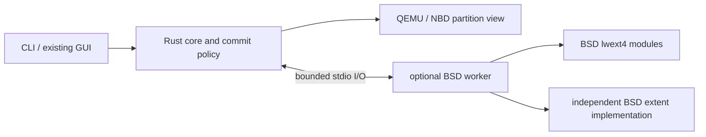

# lwext4 BSD worker P0

The optional `xetch-ext4-worker` implements file browsing/export, file
creation/replacement, mkdir, empty-directory/file removal and file/directory
rename/move. The existing fstool implementation remains the default and the
comparison engine. Public CLI commands, JSON-RPC methods, experimental opt-in,
checkpoint limits and source-image protection are shared.



## Implementation and provenance

Upstream is pinned to `58bcf89a121b72d4fb66334f1693d3b30e4cb9c5`.
[The inventory](../vendor/lwext4-origin.json) contains 47 source/header files
with retained BSD notices. The two upstream GPL implementation files,
`src/ext4_extent.c` and `src/ext4_xattr.c`, are excluded physically and from the
compiler input list. The build rejects changed/missing/unexpected inputs and
emits a SHA-256 profile and third-party license directory.
Git attributes keep these audited inputs and recorded JSON evidence in LF form,
including Windows checkouts with automatic CRLF conversion enabled.

[The new extent implementation](../native/ext4-worker/extents.c) is BSD-3-Clause.
It uses the [published extent disk format](https://www.kernel.org/doc/html/latest/filesystems/ext4/ifork.html)
and [checksum description](https://www.kernel.org/doc/html/latest/filesystems/ext4/checksums.html).
The supplied XJ380/OpenXJ380 reference informed mapping/checksum invariants and
test coverage; its implementation bodies and proprietary parent sources are not
imported. See [worker provenance and protocol](../native/ext4-worker/README.md).

The P0 found and fixed:

- An interaction between zero initialization in the new extent allocator and
  lwext4's direct payload writes: a dirty cached zero block could overwrite the
  payload at checkpoint. Data initialization now avoids dirty metadata caching.
- Journal checksum byte order, sequence encoding, escaped-payload CRCs,
  per-descriptor LAST_TAG, legacy feature-field selection and transaction-ID
  preservation across worker sessions in BSD lwext4 code.
- New indexed-directory leaf initialization before checksum calculation.
- Reads of sparse holes and unwritten extents incorrectly treating block zero
  as payload; the reader now returns zero bytes for absent mappings.
- Zero-length preallocated inode truncation/deletion leaking reservations.
- The independent debugfs oracle treating inode-zero deleted slots as live
  files. It now follows kernel namespace semantics; operation logs include
  upload lengths and hashes for reproducing differences.

BSD upstream modifications remain reviewable in
[lwext4-xetch.patch](../vendor/lwext4-xetch.patch). The source inventory records
both original and modified hashes; a license notice is not used to relabel GPL
implementation code.

## Selecting the engine

```bash
python3 scripts/build_ext4_worker.py
cargo build --locked --release

XETCH_EXT4_ENGINE=lwext4 target/release/xetch file list sample.img
XETCH_EXT4_ENGINE=lwext4 target/release/xetch --experimental-filesystems \
  file put --workspace session --source payload.bin --destination /payload.bin

# Explicit comparison with the existing implementation:
XETCH_EXT4_ENGINE=fstool target/release/xetch file list sample.img
```

The worker is found beside the backend or through `XETCH_EXT4_WORKER`. For
Windows, build with `python3 scripts/build_ext4_worker.py --target windows` in
Linux/WSL with MinGW installed; build the backend with the existing native
Windows command. Set `$env:XETCH_EXT4_ENGINE="lwext4"` before starting the CLI
or GUI. Unknown engine names and missing workers fail explicitly; operations
do not silently switch to the comparison engine.

New-image formatting still uses the existing formatter. The optional worker
handles file operations inside the same transactional QCOW2 child. A failed
worker, block operation or validation cannot advance the workspace manifest.
QEMU and worker processes use the same managed lifetime mechanism.

## Validation

```bash
cargo build --locked --release --workspace --bins \
  --example qsd_fault_proxy --example ext4_protocol_probe
cargo build --locked --release -p xetch-cli --features validation-hooks \
  --target-dir target/validation-linux
python3 scripts/lwext4_validate.py --suite all --wsl-distribution Ubuntu-22.04 \
  --directory /tmp/xetch-lwext4-p0 --output artifacts/lwext4-linux.json

# Windows native backend/worker, using Linux/WSL for independent driver checks:
python3 scripts/lwext4_validate.py --suite all --wsl-distribution Ubuntu-22.04 \
  --binary target/windows/release/xetch.exe \
  --directory artifacts/lwext4-windows --output artifacts/lwext4-windows.json
```

Omit `--wsl-distribution` on a Linux host with the existing restricted root
mount helper available through sudo. Suites can run separately:
`interoperability`, `extents`, `journal-escape`, `boundaries`, `io-faults`, `stress`.
The default stress configuration is two seeds with 1,000 operations each and
independent fsck/reference-model/kernel checks every 16 operations. The runner
freezes the backend, fault variant, worker and probe and records their hashes.

The matrix reuses the existing kernel roundtrip, journal-profile, commit-boundary,
QEMU fault and fragmented-random validation methods. Additional cases compare
both engines on the same kernel-generated source, cross-read both exports,
preserve hardlinks/32-bit owners/modes, check sparse and unwritten data, delete
empty preallocations and protect excluded xattrs. A separate fixture has a
depth-two extent tree with over 1,000 physical runs and a bad-node-CRC negative
case. Worker-only termination is exercised after greeting and after the first
durable write; malformed frames cover bounds, oversized messages, wrong magic,
read-only writes and unexpected exit.

Current kernels replay prepared CSUM_V2 logs and upgrade subsequent writes to
V3. A dedicated fixture puts the JBD2 magic into a free inode's unused bytes,
refreshes its checksum and requires independent fsck to accept the source. A
neighboring inode update then journals that magic-prefixed inode-table block.
The test checks the ESCAPE tag and zeroed log prefix, rolls back the home inode
table and requires real kernel replay to restore the updated inode. Regular
file data remains ordered/direct; this test does not assume data journaling.

## Recorded results

The final native backends and workers passed on 2026-11-16. Linux kernel
verification ran on WSL2 kernel `6.18.33.2-microsoft-standard-WSL2`, with
e2fsprogs 1.46.5. Windows operations used the native MSVC Rust backend and native
MinGW x64 worker, with WSL used only for the independent filesystem checks.

| Evidence | Linux x64 | Native Windows x64 |
| --- | --- | --- |
| P0 matrix | 15 cases / 205 check groups | 15 cases / 205 check groups |
| Worker seeded mixed operations | 2,000 | 2,000 |
| Existing fstool control operations | 2,000 | 2,000 |
| Deep extent fixture | depth 2 / 1,969 runs / 6,264 anchors | depth 2 / 1,923 runs / 6,264 anchors |
| Full Rust workspace, including ignored tests | 32 passed / 0 failed / 0 ignored | 30 passed / 0 failed / 0 ignored |
| Clippy, all targets and features | passed | passed |

The random suites use seeds `0x5eed` and `0xc0ffee` for each engine/platform.
Their combined 8,000 operations include expected rejection attempts. There were
504 snapshot kernel read/write roundtrips and eight final kernel checks; each
snapshot also checks the complete namespace/content model and independent fsck.
Operation-log hashes, counters, sequential steps and payload-hash presence were
cross-checked. Candidate and control stress fixtures are generated separately;
the differential suite additionally uses one identical source for both engines.

The Windows GUI passed 15 controller/rendering checks with the selected worker,
plus independent fsck and debugfs payload verification. All suites use coherent
frozen backend/worker hashes. No test mounts or backend/worker/QEMU processes
remained after completion.

Machine-readable records contain the full case lists and binary hashes:
[Linux matrix](lwext4-linux-results.json),
[Windows matrix](lwext4-windows-results.json),
[quality and source-policy checks](lwext4-quality-results.json), and
[Windows GUI](lwext4-windows-gui-results.json).
The source-policy checks cover missing/unexpected/modified files and GPL notice
rejection; reversing the reviewed BSD patch recovers all 47 original file hashes.

## P0 limits

- xattr/default-ACL mutations are explicitly protected; use the existing engine
  for these cases. A BSD replacement for the GPL xattr implementation is not
  included in this stage.
- Extent admission is bounded to 1/2/4 KiB blocks, depth at most five, 16,384
  records and 4,096 external nodes per inode. The depth-two fixture does not
  constitute a claim that every deeper/capacity limit has been exercised.
- Dirty or recovery-required input is rejected by shared admission policy. The
  worker does not expose automatic repair/recovery of source images.
- The new worker is not yet covered by the historical dense >4 GiB reports.
  Those reports remain evidence for the original engine's tested binaries.
- Process faults and finite seeded workloads do not certify physical power loss,
  arbitrary instruction interruption, 24-hour endurance, hostile-image isolation,
  macOS/ARM64 or all ext4 features. Windows directory sync remains a no-op.
- The new worker is an opt-in P0 component. No remote CI execution is claimed
  until the new configuration actually runs.
