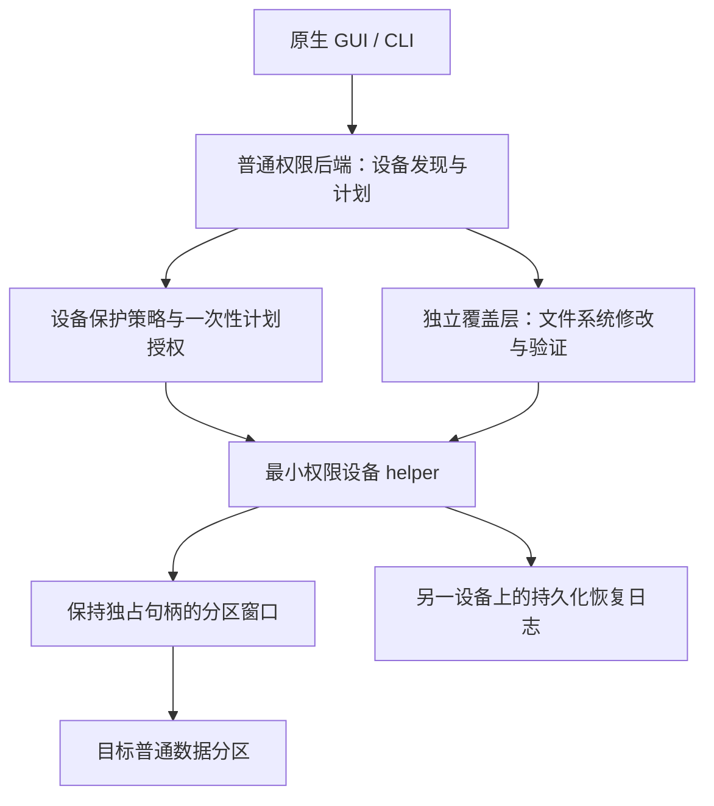

# 本机分区编辑方案（规划，尚未实现）

可以增加本机分区编辑，但物理设备需要独立的准入、权限、占用与恢复流程。
本轮不打开物理设备、不修改宿主机分区，也不把现有镜像命令隐式扩展成设备写入。

## 分阶段范围

| 阶段 | 交付与准入 |
| --- | --- |
| D0：只读发现 | Windows/Linux 枚举磁盘、分区、文件系统、扇区大小和使用关系，显示禁止写入原因；来源能保持一致时才允许导出镜像，在线系统卷另评 VSS/离线方案 |
| D1：模拟设备 | 用新建 VHD/loop 设备验证独占、边界、撤销确认、热插拔、错误与恢复；不选择真实个人磁盘 |
| D2：普通数据分区 | 仅离线、可独占、正常关闭的基本磁盘数据分区；先支持独立非系统磁盘，保留现有实验文件系统开关 |
| D3：扩大兼容性 | 再评估系统磁盘上的独立数据卷、4Kn、更多存储拓扑；每一项单独通过验收后开放 |
| 独立后续项目 | 分区表修改、缩放、移动分区、引导修复、解密、RAID/LVM/Storage Spaces 写入，不混入首版文件编辑 |

首版设备编辑限文件系统内的浏览、导入导出、新建目录、改名和删除。格式化物理分区应作为另一类破坏性操作单独设计，默认不提供。macOS 先保留镜像功能，物理设备接入需另行验证。

## 后端强制保护

| 情形 | 行为 |
| --- | --- |
| 当前 Windows 系统卷、启动链涉及的卷，Linux `/`、`/boot`、`/boot/efi` 及其底层设备 | 禁止写入；弹窗确认不能解除保护 |
| EFI System Partition、MSR、Windows 恢复/OEM 保留分区、MBR 活动/系统保留分区、识别到的其他系统引导分区 | 禁止写入，显示识别依据；不依赖盘符或卷标 |
| 页面文件、休眠、崩溃转储、活动 swap，或承载当前工作区、程序、备份/恢复日志的分区 | 禁止写入 |
| 有挂载、打开文件、占用映射，或不能持续持有独占权的分区 | 不写入；提示用户退出使用后重新扫描，不强制驱逐占用者 |
| BitLocker/LUKS、动态磁盘、Storage Spaces、LVM/MD/DM、RAID、多盘卷、快照/克隆身份不明 | 首版拒绝写入；拓扑不明也拒绝 |
| 脏卷、需要日志恢复、休眠卷、只读介质、设备身份变化 | 拒绝写入；修复/恢复仍在独立副本上进行 |

保护应同时覆盖卷、分区及其底层依赖图。无法可靠判断系统角色、挂载命名空间或持有者时，返回明确的禁止原因。首版不提供强制写系统分区的开关。测试必须直接调用后端，证明绕过界面同样不能解除保护。

## 用户流程与确认

1. 默认以只读方式列出本机设备。显示厂商/型号、序列号或其他稳定身份、总容量、连接方式、分区 GUID、起始偏移、容量、文件系统、挂载状态及保护原因。
2. 选择允许编辑的普通分区，明确告知并取得临时卸载/独占同意。必要时申请受限 helper 权限，先完成系统缓存静止、独占和状态检查，再建立只读来源；独占租约从读取/编辑阶段一直保持到提交或取消结束。文件修改放在另一设备的覆盖层中，helper 的写入模式仍关闭。不能维持来源稳定时，只提供一致性备份为镜像，不让覆盖层依赖仍在变化的挂载卷。
3. “写入本机分区”显示完整计划：准确目标身份、操作清单、预计修改范围、备份位置，以及写入开始后中断可能留下部分更新的说明。
4. 必须弹出确认对话框，按钮默认取消；要求输入与目标绑定的确认短语。关闭窗口、取消或确认超时均保持零设备写入。普通镜像另存保留原有流程。
5. 用户确认后才授予绑定计划的设备写入许可；尚未获得必要系统权限时再请求 UAC/polkit。已经因只读/独占会话启动的特权 helper 不必重复弹 UAC，但必须验证新的单次写入许可。重新检查设备身份、保护规则、源块旧值和仍持续持有的独占句柄；租约丢失、计划或目标变化即作废授权，不能对变化后的设备继续写入。
6. 在实际写入之前完成恢复材料落盘并检查空间、设备身份和源块旧值，再执行写入、flush、读回核验，最后释放独占句柄。输出明确的完成或恢复状态。

读取原始扇区、锁定或备份为镜像若需要管理员权限，可单独申请受限授权；取得管理员权限不等于获得应用层的写入许可。锁定之前的系统缓存刷新可能落盘操作系统先前已经排队的写入，因此“未确认不写入”特指 xEtch/helper 不提交编辑数据，不能承诺操作系统完全不产生磁盘 I/O。系统/引导分区的离线修复如需将来开放，应作为 WinPE/Live USB 下的独立方案评审。

弹窗是产品交互，后端还需短期、单次、绑定会话/设备身份/容量/分区范围/计划哈希的授权凭据。CLI 首版只允许交互确认，不把普通 `--yes` 当作设备写入授权；JSON-RPC 客户端使用同一授权状态机。凭据不通过明文命令行参数长期保存。保护规则不能被凭据绕过。

## 架构与平台接入

保留文件系统 worker 的有界块请求协议，在其下新增块设备来源抽象；设备 helper 只接收已识别设备与已授权分区范围，不提供任意文件写入或任意物理磁盘路径接口。所有范围计算检查溢出和扇区对齐，用户文件路径不能冒充设备标识。

Windows 使用系统卷/磁盘 API 获取设备与卷的对应关系，结合 GPT 类型、启动配置、分页/转储信息和实时使用状态判定角色。使用卷句柄建立独占租约，并将该句柄用于受限 I/O。微软文档指出，`FSCTL_LOCK_VOLUME` 在系统卷、页面文件或打开文件的卷上会失败；单纯卸载不能保证不会被其他进程重新挂载。因此不能把 `FSCTL_DISMOUNT_VOLUME` 的成功当作安全独占的证明。[卷锁定](https://learn.microsoft.com/en-us/windows/win32/api/winioctl/ni-winioctl-fsctl_lock_volume)、[卷卸载](https://learn.microsoft.com/en-us/windows/win32/api/winioctl/ni-winioctl-fsctl_dismount_volume)。

卷可能对应多个磁盘 extent，GPT 类型与分区身份也应来自系统查询；首版拒绝多 extent/复杂映射，而不是假定盘符对应一个简单分区。[卷磁盘映射](https://learn.microsoft.com/en-us/windows/win32/api/winioctl/ni-winioctl-ioctl_volume_get_volume_disk_extents)、[GPT 分区信息](https://learn.microsoft.com/en-us/windows/win32/api/winioctl/ns-winioctl-partition_information_gpt)。

Linux 结合 sysfs、设备号、mountinfo、swap 和 holders/slaves 关系建立依赖图，再通过受限特权 helper 获取内核强制的排他设备访问。不能只检查当前进程的挂载命名空间或使用建议性 flock；无法排除其他命名空间、容器或映射占用时不写入。不同内核的排他语义与竞态需在 D1 实验确认；复杂 DM 拓扑先禁止。[Device Mapper 文档](https://docs.kernel.org/admin-guide/device-mapper/index.html)。

首版要求 512 字节逻辑扇区，并拒绝分区起止边界未按设备物理扇区大小对齐的情况。恢复日志按物理扇区保护修改前的数据。4Kn 必须先改造当前分区解析、I/O 对齐和恢复记录，不能直接复用现有固定 512 字节假设。

## 写入与恢复边界

覆盖层能让确认前的编辑可撤销，不能令最终物理写回天然原子化。禁止直接把目前 QCOW2 的“失败丢弃子层”结论套用到真实设备。

建议先实现受限的撤销日志提交器：在独占租约内记录并持久化所有被覆盖块的旧值、顺序和校验和，随后才写目标；按明确状态记录 flush 和完成标记。恢复材料必须放在不同的物理设备上，不能在待写分区或它的同盘故障域。空间不足时在零写入阶段退出。

当前镜像 worker 的父进程退出即终止子进程策略不能直接套用到物理提交 helper。物理 helper 必须独立持有租约与恢复记录，按持久化状态完成提交或恢复；前端消失不代表物理写入已经回滚。

写入一旦开始，进程崩溃、掉电或设备移除可能留下部分更新。下一次打开必须先识别未完成操作，保持设备写保护，并提供验证后恢复或只读导出路径；不能自动继续编辑，也不能承诺所有硬件故障都可回滚。恢复依赖设备和旧值日志仍可读取，真实断电验收通过前必须明确保留这一限制。

## 验收门槛

- 在新建 VHD/loop 上验证被保护分区、同盘保护、边界写入、未授权 RPC、过期/复用凭据和取消确认均不产生 helper 的目标数据写请求。
- 验证系统角色变化、盘符重用、序列号缺失/重复、设备重插、分区 GUID 克隆、分区范围变化、锁失败、挂载竞态和其他命名空间占用。
- 对恢复日志落盘、首个目标写入、每批 flush、完成标记和释放租约分别注入进程退出、EIO、ENOSPC、数据损坏与设备断开。Linux 可评估 dm-flakey 等官方故障目标，但仅作用于专用测试设备。[dm-flakey](https://docs.kernel.org/admin-guide/device-mapper/dm-flakey.html)。
- Windows/Linux 的同一文件系统执行真实驱动往返、独立一致性检查和全量哈希，覆盖 xattr/ACL、硬链接、碎片与大文件。
- 确认框、默认取消、键盘操作、可访问性、重复点击和前端异常退出需完成真实交互验收；现有 WinUI 控制器测试不能代替这些验收。
- 完成至少一套专用可断电硬件的恢复测试后，再评估把设备写入功能从实验状态提升。

实施优先顺序为 D0 → D1 → D2。D0 完成后再决定是否进入真实设备写入；实现 D2 前应评审保护规则和恢复格式。以上是设计提案，不代表当前软件已支持物理分区编辑。
